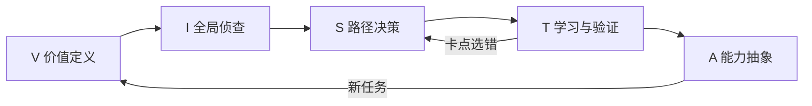

# VISTA｜AI 时代的任务驱动学习

**从一件值得做的事开始，让 AI 帮你找到卡点、学会必要知识，并用独立实践检验能力。**

VISTA 将学习组织成五个可迭代的阶段：价值定义、全局侦查、路径决策、学习验证、能力抽象。本项目提供可阅读的方法说明、可安装的 AI 学习教练 skill，以及可复现的演示和验收用例。

当前 skill 版本：**1.1.0**。
## 为什么做这个项目

AI 可以快速生成解释、计划和成果。学习者仍然需要判断：这件事值得学吗？真正卡在哪里？哪些可以交给工具？哪些判断必须自己掌握？换一道题、过几天，还能做到吗？

VISTA 用两条独立的验收线回答这些问题：

- **成果线**：任务有没有完成，产物是否符合事先约定的标准？
- **能力线**：学习者在什么帮助条件下能解释、运用和迁移，证据是什么？

AI 帮忙完成的报告可以交付；报告写得好，并不自动证明学习者已掌握分析能力。

## 五个阶段

| 阶段 | 要解决的问题 | 留下什么 |
|---|---|---|
| V · Value | 为什么学，怎样算完成？ | 一句话任务与验收标准 |
| I · Inspect | 领域有什么，哪些与当前任务有关？ | 最小领域地图 |
| S · Select | 最阻塞的一步是什么，选择学习还是借助工具？ | 一个突破点和下一动作 |
| T · Test | 学到哪里够用，如何证明会了？ | 主动作答、最小产物、证据 |
| A · Abstract | 什么条件下可复用，换场景如何调整？ | 规则、边界、迁移表现 |



每轮默认只推进一个问题或行动；已有目标和基础可以跳步。用户要完整方案或直接成果时可以直接交付，能力验证另行记录。

## 先看一次体验

> **学习者**：我会 SQL 的 SELECT 和 GROUP BY，今天要按客户统计实付金额，但一联表就变大。
>
> **AI 教练**：先看最可能的卡点。一笔 100 元订单有两条商品明细，联表后直接 SUM 订单金额，会得到多少？
>
> **学习者**：200，因为同一笔订单出现了两行。
>
> **AI 教练**：你已定位到重复计数。现在一位客户有两笔不同订单，每笔都是 100 元。用 SUM(DISTINCT 金额) 会出现什么问题？

这段展示的是“从具体错误反推必要知识”的交互方式。完整的[演示对话与验证产物](examples/sql-learning-demo.md)包含纠偏、迁移和状态快照。**演示为编写的虚构案例，不是实际用户测评记录。**

## 快速开始

### 在 Codex 项目中使用

1. 下载或克隆本仓库，保留 `skills/vista-learning/` 整个目录。
2. 将它复制到目标项目的 `.agents/skills/vista-learning/`。
3. 在 Codex 中确认该 skill 已被识别，再输入：

```text
使用 vista-learning。我要在三天内独立完成一份订单清洗结果。
我会基础 Python，但不确定重复记录如何处理。
请先用一道题诊断，再按需要教学，每次只推进一个动作。
```

Codex CLI / IDE 扩展也可使用 `$vista-learning` 显式调用。安装位置与调用方式依据 [OpenAI 官方 skill 文档](https://learn.chatgpt.com/docs/build-skills)，核对日期：2026-10-20。客户端若未发现更新，可尝试重新启动。

已有同名版本时先确认所选版本与路径，避免两份同名 skill 混用。本仓库的 `skills/` 是分发源码目录，不表示克隆后已自动安装。

### 在普通 AI 对话中试用

把 [SKILL.md](skills/vista-learning/SKILL.md) 作为会话材料提供，并明确要求按协议教学；进入教学评估时，再提供 [评估协议](skills/vista-learning/references/teaching-and-assessment.md)。助手不能读取仓库时，需要你粘贴或上传所需文件。

仅输入 skill 名称不代表已安装。普通对话方式可体验流程，但不保证客户端具备自动加载引用文件或持久保存进度的能力。

Skill 本身不需要脚本、API Key 或外部服务；实际运行仍依赖使用者自己的 AI 客户端与服务。

## 可以怎么用

| 需要 | 可以这样说 |
|---|---|
| 边做边学 | “用 VISTA 教我做一份目标岗位业务分析，先诊断我会什么。” |
| 定位卡点 | “我看得懂 SQL，但总是写错联表，请诊断。” |
| 测独立能力 | “给我一道新情境题，先不要提示或答案。” |
| 保留知识 | “隔了三天，请换一道题检查我是否还会。” |
| 迁移 | “我会订单去重，请测试我能否迁移到工单数据。” |
| 续学 | “这是上次状态快照，请从未解决的卡点继续。” |

## 项目内容

```text
README.md
docs/
  design-and-evaluation.md         方法取舍、局限、评估方式与本次改进
examples/
  sql-learning-demo.md             明确标记为虚构的完整演示
skills/vista-learning/
  SKILL.md                        AI 教练执行协议
  references/                     教学评估、卡点诊断、调用方式
  assets/                         状态快照、实践卡、迁移卡
  tests/acceptance-cases.md         24 个行为验收场景
  tests/evaluation-record.md       实际运行后的记录模板
```

## 如何判断它有没有用

先检查 AI 是否遵守协议，再检查学习者是否获得能力。使用[行为验收用例](skills/vista-learning/tests/acceptance-cases.md)检查“会不会一次灌输全部内容、泄露测试答案、把 AI 代做误判为掌握”等行为。

真实学习效果应查看任务产物、独立新题、帮助程度、耗时以及延迟复测。请记录失败案例；单次体验满意或一个案例做对，都不足以证明方法普遍有效。具体做法见[设计与评估说明](docs/design-and-evaluation.md)。

## 项目定位与当前边界

这里可分享的是 **VISTA 的方法、教练指令、模板和案例**。项目不包含模型权重、个人账号、聊天记忆或独立运行的 AI 服务；在 GitHub 页面阅读文档本身不会启动对话。

VISTA 是对任务驱动、诊断、实践反馈和经验迁移的工作流组织，不宣称发明了全部学习原理，也不宣称经过临床或教育实验验证。不同模型可能出现不同执行表现。

仓库尚未指定开源许可证，发布前由维护者确定授权方式。欢迎用匿名案例反馈具体失败：输入是什么、AI 如何回答、你预期什么、实际发生什么。请勿上传私人学习记录、客户明细或账号凭据。
